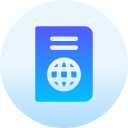
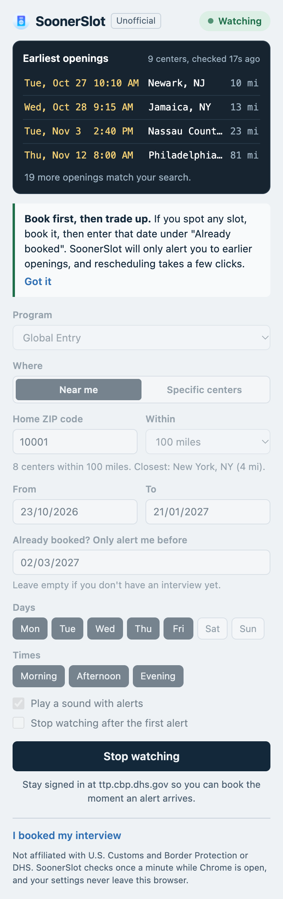
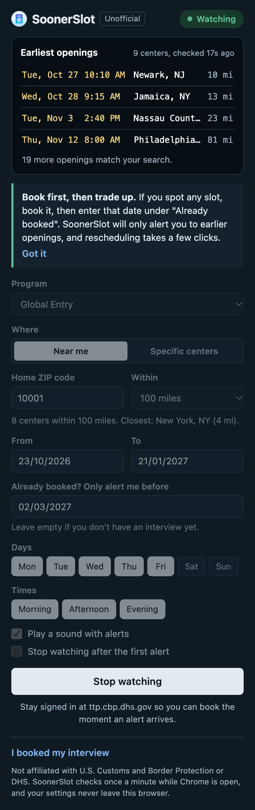
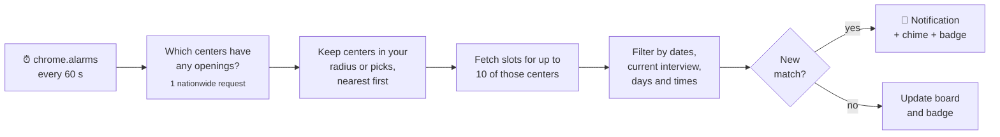

<div align="center">



# SoonerSlot

**Get alerted the minute an earlier Global Entry, NEXUS, SENTRI or FAST interview opens near you.**

Free, no account, and your settings never leave your browser.

[](https://developer.chrome.com/docs/extensions/develop/migrate/what-is-mv3)
[](#install)
[](https://github.com/UzairJIqbal/soonerslot/actions/workflows/ci.yml)
[](LICENSE)

<br />


&nbsp;&nbsp;&nbsp;


</div>

---

> [!IMPORTANT]
> SoonerSlot is an independent project. It is **not affiliated with, endorsed by or connected to U.S. Customs and Border Protection (CBP) or the Department of Homeland Security (DHS).** It never books anything for you; it tells you when an opening appears so you can book it yourself on the official scheduler.

## Why SoonerSlot

Trusted Traveler interviews are booked months out, but cancellations free up earlier slots all day long. They are usually gone within minutes. Most tools that watch for them charge $20–35, cover a handful of centers and ask for your phone number. SoonerSlot does the job for free, inside the browser you already have open.

| | |
|---|---|
| **Search by distance, not by name** | Enter your ZIP code and a radius (25 miles to anywhere in the U.S.). SoonerSlot finds every enrollment center in range, nearest first. Or pick up to five specific centers. |
| **Only earlier than what you have** | Already booked for March? Enter that date and you'll only hear about openings before it. Book any slot now, then trade up. |
| **Your days, your hours** | Skip weekends, or mornings, or both. Openings outside your filters never trigger an alert. |
| **Alerts you can't miss** | A notification that stays on screen, an optional chime, and a badge count on the toolbar icon. One click opens the CBP scheduler. |
| **A live board of openings** | The popup shows the earliest matching slots with date, time, city and distance, refreshed every minute. |
| **All five programs** | Global Entry, NEXUS, SENTRI, FAST (Canada border) and FAST (Mexico border). |
| **Polite by design** | One check per minute, a cap on requests per check, and automatic back-off when CBP's scheduler is having trouble. |

## Install

### From the Chrome Web Store

Coming soon.

### From source

1. Download this repository (**Code → Download ZIP**) and unzip it, or clone it:
   ```sh
   git clone https://github.com/UzairJIqbal/soonerslot.git
   ```
2. Open `chrome://extensions` and switch on **Developer mode** (top right).
3. Click **Load unpacked** and select the `soonerslot` folder.
4. Pin SoonerSlot from the puzzle-piece menu so the badge count is visible.

Requires Chrome 116 or later, or a Chromium browser such as Edge or Brave.

## Using it

1. Choose your program.
2. Pick **Near me** and enter your ZIP code and radius, or pick **Specific centers**.
3. Set the date range you can make. If you already have an interview, enter it under **Already booked?**.
4. Narrow the days and times if you need to, then click **Start watching**.

When a matching slot appears you get a notification. Click it, and the official scheduler opens in a new tab.

> [!TIP]
> Stay signed in at [ttp.cbp.dhs.gov](https://ttp.cbp.dhs.gov) while SoonerSlot is watching. Openings are often taken within a few minutes, so the time you save not logging in matters.

SoonerSlot checks only while Chrome is running. If your computer sleeps, checking resumes when it wakes.

## How it works



- **Distance without location access.** A bundled table of U.S. ZIP code centroids (from the Census Bureau) is used to measure straight-line distance from the ZIP you type to each center. SoonerSlot never asks for your location.
- **Times in the center's time zone.** CBP publishes slot times as local wall-clock time at each center. SoonerSlot compares and displays them in that zone, so "9:15 AM in Seattle" is 9:15 AM wherever you are.
- **Only new openings alert you.** Every slot you've already been told about is remembered, so a slot that stays open doesn't ping you every minute.
- **Built for Manifest V3.** The service worker can shut down at any time, so all state lives in `chrome.storage.local`. Sound plays through an offscreen document.

## Privacy

SoonerSlot has no servers, no accounts, no analytics and no tracking. Your search settings are stored only in your browser, and the only network requests it makes go to CBP's public scheduling API at `ttp.cbp.dhs.gov`. See the full [privacy policy](PRIVACY.md).

| Permission | Why it's needed |
|---|---|
| `storage` | Saves your search settings and the latest results in your browser. |
| `alarms` | Runs the once-a-minute check. |
| `notifications` | Shows the alert when a slot opens. |
| `offscreen` | Plays the alert chime (Manifest V3 service workers can't play audio directly). |
| `https://ttp.cbp.dhs.gov/*` | Reads enrollment centers and open slots from CBP's public scheduler. |

## Project structure

```
├── manifest.json          Extension manifest (MV3)
├── background.js          Service worker: scheduling, checks, alerts, back-off
├── lib/
│   ├── config.js          Programs, limits and defaults
│   ├── api.js             CBP scheduler API client
│   ├── locations.js       Enrollment centers, cached for 24 hours
│   ├── geo.js             ZIP code lookup and distance
│   ├── search.js          Picks centers and finds matching slots
│   ├── slots.js           Time zone–aware slot filtering and formatting
│   └── notify.js          Notifications and sound
├── popup/                 Toolbar popup (HTML, CSS, JS; no frameworks)
├── offscreen/             Offscreen document that plays the chime
├── data/zips.json         ZIP code → [lat, lon] table
├── sounds/chime.wav
├── images/                Extension icons
├── tools/                 Script that builds data/zips.json
└── scripts/               Validation and packaging
```

No build step and no runtime dependencies: the code you read is the code that runs.

## Development

Requires Node.js 22 or later for the helper scripts.

```sh
npm run check     # validate the manifest, referenced files and every JS module
npm run package   # build dist/soonerslot-<version>.zip for the Chrome Web Store
```

After editing, click the reload icon on SoonerSlot's card in `chrome://extensions`. To debug the background, click **Service worker** on the same card.

<details>
<summary>Rebuilding the ZIP code table</summary>

`data/zips.json` is generated from the Census Bureau's [ZCTA gazetteer file](https://www.census.gov/geographies/reference-files/time-series/geo/gazetteer-files.html). Download and unzip the latest `*_Gaz_zcta_national.txt`, then run:

```sh
npm run build:zips -- path/to/2024_Gaz_zcta_national.txt data/zips.json
```

A few enrollment centers sit at postal codes that aren't ZCTAs (airports, Canadian border crossings). Their coordinates are added by hand in the `EXTRA` table at the top of `tools/build-zip-table.py`.

</details>

## Roadmap

- [ ] Phone alerts through free push services (ntfy, Telegram, Discord)
- [ ] Remote (Zoom) renewal interviews
- [ ] History of when slots tend to open at each center
- [ ] One-click prefill on the CBP booking page

Ideas and bug reports are welcome in [Issues](https://github.com/UzairJIqbal/soonerslot/issues). See [CONTRIBUTING.md](CONTRIBUTING.md) before opening a pull request.

## Acknowledgements

ZIP code coordinates come from the U.S. Census Bureau's ZCTA gazetteer, which is in the public domain. Global Entry, NEXUS, SENTRI and FAST are programs of U.S. Customs and Border Protection.

## License

[MIT](LICENSE) © 2026 Uzair Iqbal
