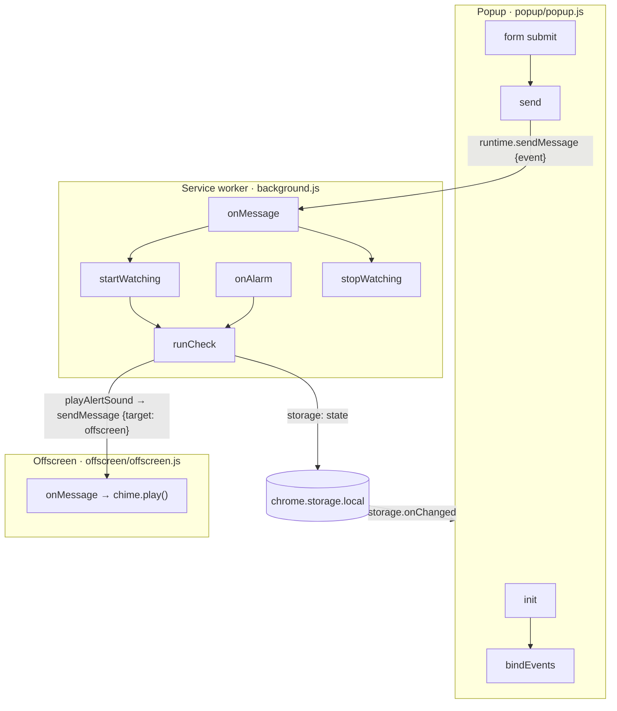
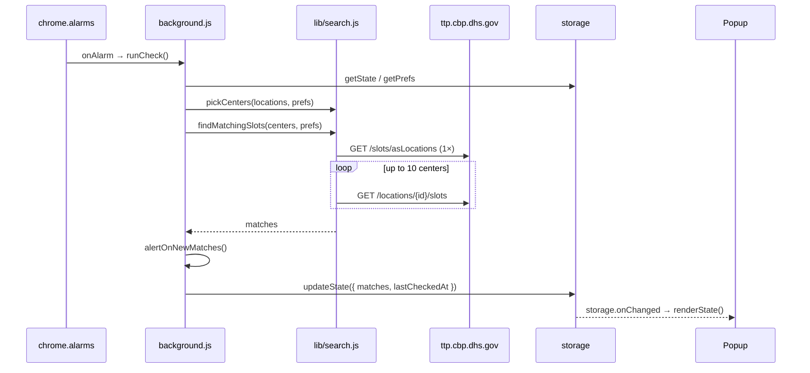

# Execution flow

A map of how SoonerSlot runs: where execution starts, the order things happen in, and which function calls which. Line numbers refer to the current `main` branch. **Update this file whenever a change moves an entry point, adds a step or shifts a call site.**

Notation: `file:line functionName` is a definition. `A → B` means A calls B. Lines marked **✎** were changed in the most recent task (see [Changes in this task](#changes-in-this-task)).

## Contents

1. [Entry points](#1-entry-points)
2. [Extension lifecycle](#2-extension-lifecycle-install-and-browser-start)
3. [Popup opens](#3-popup-opens)
4. [User starts watching](#4-user-starts-watching)
5. [The check loop](#5-the-check-loop-every-60-seconds)
6. [Alerting](#6-alerting)
7. [User stops, or books](#7-user-stops-or-books)
8. [Notification clicked](#8-notification-clicked)
9. [Popup edits settings](#9-popup-edits-settings)
10. [Build and CI](#10-build-and-ci-not-shipped)
11. [Shared state](#11-shared-state-chromestoragelocal)
12. [Call index](#12-call-index-caller--callee)
13. [Changes in this task](#changes-in-this-task)

---

## 1. Entry points

SoonerSlot has three runtime contexts. They never call each other directly: they talk through `chrome.runtime.sendMessage` and through shared `chrome.storage.local`.

| Context | Loaded from | Starts at | Lives for |
|---|---|---|---|
| Service worker | `manifest.json` → `background.service_worker` (module) | Top level of `background.js` registers 7 listeners (lines 165–214) | Wakes on events; Chrome stops it when idle |
| Popup | `manifest.json` → `action.default_popup` → `popup/popup.html:148` loads `popup.js` (module) | `popup/popup.js:605 init()` | While the popup is open |
| Offscreen document | Created on demand by `lib/notify.js:29` | `offscreen/offscreen.js:1` (creates the `Audio`), listener at line 3 | Until Chrome closes it |

Event listeners registered by the service worker:

| Event | Registered at | Handler calls |
|---|---|---|
| `runtime.onInstalled` | `background.js:165` | storage cleanup, `ensureAlarm` |
| `runtime.onStartup` | `background.js:178` | `ensureAlarm` |
| `alarms.onAlarm` | `background.js:184` | `runCheck` |
| `notifications.onClicked` | `background.js:190` | `openScheduler` |
| `notifications.onButtonClicked` | `background.js:195` | `openScheduler` |
| `runtime.onMessage` | `background.js:200` | `startWatching` / `stopWatching` |

---

## 2. Extension lifecycle (install and browser start)

**On install or update**

1. `background.js:165` `onInstalled` handler
2. → `chrome.storage.local.remove(LEGACY_KEYS)` (line 166). Removes keys left by the pre-1.0 prototype.
3. If `reason === "install"` → `chrome.storage.local.set({ prefs: DEFAULT_PREFS, state: DEFAULT_STATE })` (line 168).
4. → `getState()` (`background.js:35`). If `isRunning` → `ensureAlarm()` (`background.js:54`, called at line 174).

**On browser start**

1. `background.js:178` `onStartup` handler
2. → `getState()` → if running → `ensureAlarm()` (line 180).

`ensureAlarm` (`background.js:54`) → `chrome.alarms.get` (55) → if missing, `chrome.alarms.create(ALARM_NAME, { periodInMinutes: 1 })` (57).

---

## 3. Popup opens

1. `popup/popup.html` parses, then loads `popup.js` as a module. Module top level builds the `el` lookup with `$` (`popup.js:29`).
2. `popup.js:605` → `init()` (`popup.js:577`)
   1. `chrome.storage.local.get(["prefs", "state", "ui"])` (578)
   2. If not running: defaults the date range to today … +90 days and clears a past `currentAppt` → `addDaysISO` (`lib/slots.js:43`), `todayISO` (`lib/slots.js:37`) → `savePrefs()` (`popup.js:73`)
   3. → `buildStaticControls()` (598, defined 127) → `fillSelect` (100) for program and radius, `makeToggle` (111) for day and time chips
   4. → `writePrefsToForm()` (599, defined 175) → `renderMode()` (195)
   5. → `bindEvents()` (600, defined 480). See [§9](#9-popup-edits-settings).
   6. → `renderState()` (601, defined 467) → `renderStatus` (377), `renderBoard` (407) → `formatSlot` (`lib/slots.js:76`), `renderRunning` (461)
   7. → `loadLocations()` (602, defined 276)
      1. → `renderCenterPicker()` (280, defined 232). Shows "Loading centers…".
      2. → `getLocations(program)` (282) — `lib/locations.js:32`
         1. `chrome.storage.local.get("locations")` (33). Cached and under 24 h old → return the cache.
         2. Otherwise `Promise.all` → `fetchLocations(program)` (`lib/api.js:11`, called at 45) → `getJSON` (`lib/api.js:3`) → `fetch` `/schedulerapi/locations/…`
            and → `loadZipTable()` (`lib/geo.js:4`, called at 46) → `fetch("data/zips.json")`
         3. `.map(toCenter)` (49) → `toCenter` (`lib/locations.js:21`) → `titleCase` (5), `coordsFor` (13) → `normalizePostal` (`lib/geo.js:11`)
         4. `chrome.storage.local.set({ locations })` (51)
         5. On fetch failure, falls back to a stale cache, or throws.
      3. Drops picked centers the program doesn't offer → `updatePrefs` (294, defined 75)
      4. → `renderCenterPicker()` (296), `renderNearbyHint()` (297, defined 201)
         → `pickCenters(locations, prefs)` (212) — `lib/search.js:7`
         → `lookupCoords(zip)` (216) — `lib/geo.js:14`
3. Every second: `setInterval(renderStatus, 1000)` (572) keeps "checked 14s ago" current.

---

## 4. User starts watching

1. User clicks **Start watching** → form `submit` handler (`popup.js:533`).
2. Not running → `validateAll()` (539, defined 370)
   → `validateWhere()` (311) → `lookupCoords` (317) → `showError` (302)
   → `validateDates()` (336) → `todayISO`, `showError`
   → `validateFilters()` (360) → `showError`
3. Valid → `send({ event: "start", prefs })` (541) → `send` (473) → `chrome.runtime.sendMessage` (474)
4. Service worker wakes → `onMessage` (`background.js:200`) → `startWatching(message.prefs)` (206, defined 63)
   1. `chrome.storage.local.set({ prefs })` (64)
   2. → `updateState({ ...DEFAULT_STATE, isRunning: true })` (65, defined 40) → `getState` (35) → `storage.set({ state })`
   3. → `setBadge("")` (69, defined 47) → `chrome.action.setBadgeText`
   4. → `ensureAlarm()` (70)
   5. → `runCheck()` (71). The first check runs right away, without waiting a minute. See [§5](#5-the-check-loop-every-60-seconds).
5. The `state` write fires `storage.onChanged` in the popup (`popup.js:561`) → `renderState()` (567). The fieldset is disabled and the button now reads **Stop watching**.

---

## 5. The check loop (every 60 seconds)

Triggered by `chrome.alarms.onAlarm` (`background.js:184`) → `runCheck()` (186), or directly by `startWatching` (71).

`runCheck` — `background.js:99`

1. Re-entry guard: `checkInProgress` flag (100–103).
2. → `getState()` (105). Returns early if not running, or if `Date.now() < nextCheckAt` (back-off window).
3. → `getPrefs()` (109, defined 30)
4. → `getLocations(prefs.program)` (112). Usually a cache hit. See §3 step 7.2.
5. → `pickCenters(locations, prefs)` (113) — `lib/search.js:7`
   1. Nearby mode → `lookupCoords(prefs.homeZip)` (10) → `loadZipTable` → `normalizePostal`
   2. Each center → `distanceMiles(home, coords)` (`lib/geo.js:21`) → `toRadians` (19)
   3. Centers mode: keep picked ids. Nearby mode: keep centers within the radius, nearest first.
6. → `findMatchingSlots(centers, prefs)` (114) — `lib/search.js:38`
   1. → `fetchCenterIdsWithSlots(program)` (39) — `lib/api.js:17` → `getJSON` → `fetch /slots/asLocations`. **One nationwide request.**
   2. Intersect with `centers`, cap at `MAX_SLOT_REQUESTS` (10).
   3. → `searchEndDate(prefs)` (44) — `lib/slots.js:51` → `addDaysISO`
   4. For each target, **sequentially**:
      → `fetchOpenSlots(id, startDate, endDate)` (51) — `lib/api.js:24` → `getJSON` → `fetch /locations/{id}/slots`
      → `nowInZone(center.tzData)` (52) — `lib/slots.js:18`
      → `slotMatches(timestamp, prefs, nowLocal)` (54) — `lib/slots.js:59` → `parseTimestamp` (7), `searchEndDate` (51), `toUTCDate` (14)
   5. Sort by timestamp, then distance.
7. → `getState()` (117). If the user pressed Stop mid-check, discard the results.
8. → `alertOnNewMatches(matches, state, prefs)` (121). See [§6](#6-alerting).
9. → `updateState({ lastCheckedAt, matches (top 50), matchCount, notifiedKeys, … })` (126)
10. → `setBadge(count)` (136)
11. If an alert fired and `pauseAfterAlert` is on → `stopWatching({ pausedAfterAlert: true })` (139)

**On error** (`catch`, 141):
- `consecutiveErrors + 1`. From the second error on, `nextCheckAt = now + min(2^(n-1), 30)` minutes.
- → `updateState({ lastError, consecutiveErrors, nextCheckAt })` (147)
- → `setBadge("!", "#b4561b")` (154)

`finally` clears `checkInProgress` (157).

---

## 6. Alerting

`alertOnNewMatches` — `background.js:82`

1. `fresh` = matches whose `slotKey` (`lib/slots.js:93`) isn't in `state.notifiedKeys`.
2. `notifiedKeys` = all current keys plus the old ones, capped at 500.
3. If anything is fresh:
   - → `showSlotNotification(fresh[0], fresh.length)` (91) — `lib/notify.js:5` → `formatSlot` (`lib/slots.js:76`) → `chrome.notifications.create` (13)
   - If `prefs.sound` → `playAlertSound()` (93) — `lib/notify.js:26`
     → `chrome.offscreen.hasDocument` (28) → `chrome.offscreen.createDocument("offscreen/offscreen.html", AUDIO_PLAYBACK)` (29)
     → `chrome.runtime.sendMessage({ target: "offscreen", event: "playSound" })` (35)
     → `offscreen/offscreen.js:3` listener → `chime.play()` (6)
     The service worker's own `onMessage` (`background.js:201`) ignores messages with `target: "offscreen"`.
4. Returns `{ notifiedKeys, alerted }` to `runCheck`.

---

## 7. User stops, or books

**Stop**: form `submit` while running (`popup.js:535`) → `send({ event: "stop" })` (536)
→ `background.js:200 onMessage` → `stopWatching()` (209, defined 74)
→ `chrome.alarms.clear` (75) → `updateState({ isRunning: false, … })` (76) → `setBadge("")` (78)

**I booked my interview**: `popup.js:553` click handler → if running, `send({ event: "stop" })` (555), same path as above. Then shows the review link built from `chrome.runtime.id`.

**Auto-pause**: `runCheck` → `stopWatching({ pausedAfterAlert: true })` (`background.js:139`). The badge keeps its count, and the popup shows "Paused".

---

## 8. Notification clicked

`background.js:190 onClicked` or `background.js:195 onButtonClicked`
→ `openScheduler()` (191 / 196, defined 161) → `chrome.tabs.create({ url: SCHEDULER_URL })` (162)
→ `chrome.notifications.clear(id)` (192 / 197)

Board rows in the popup are plain `<a href={SCHEDULER_URL} target="_blank">` links built in `renderBoard` (`popup.js:407`). They involve no extension code.

---

## 9. Popup edits settings

Every handler is registered in `bindEvents` (`popup.js:480`). Each one writes through `updatePrefs` (75) → `savePrefs` (73) → `chrome.storage.local.set({ prefs })`.

| Control | Handler line | Then calls |
|---|---|---|
| Program select | 481 | `updatePrefs` (482) → `loadLocations` (483) |
| Near me / Specific centers | 487 | `updatePrefs` (488) → `renderMode` (489) → `showError` |
| ZIP input | 495 | `updatePrefs` (498) → `renderNearbyHint` (500) |
| Radius select | 503 | `updatePrefs` (504) → `renderNearbyHint` (505) |
| Center picker | 508 | `updatePrefs` (511) → `renderCenterPicker` (514) |
| Remove-center button | created in `renderCenterPicker` (232) | `updatePrefs` → `renderCenterPicker` |
| From / To / Already booked | 522 | `updatePrefs` (523) → `validateDates` (524) |
| Day and time chips | created by `makeToggle` (111) in `buildStaticControls` (127) | `updatePrefs` → `validateFilters` |
| Sound / Stop after first alert | 528 / 529 | `updatePrefs` |
| Got it (tip) | 548 | `chrome.storage.local.set({ ui })` (550) |
| Storage changes | 561 | `renderState` (567) when `state` changes |

Settings are locked (`fieldset.disabled`, set in `renderRunning`, 461) while watching. The service worker therefore always runs with the `prefs` saved at start.

---

## 10. Build and CI (not shipped)

| Entry | Order |
|---|---|
| `npm run check` | `package.json` → `scripts/validate.mjs`: parse `manifest.json` (13) → check that referenced files exist → compare `package.json` and manifest versions → `walk` (34) every `.js`/`.mjs` → `node --check` each → check that `data/zips.json` has at least 30,000 entries |
| `npm run package` | `scripts/package.sh` → read the version from `manifest.json` → `zip` the runtime files only → `dist/soonerslot-<version>.zip` |
| `npm run build:zips -- <gaz.txt> data/zips.json` | `tools/build-zip-table.py main()` → read the Census ZCTA TSV → merge the `EXTRA` overrides → write JSON |
| GitHub Actions | `.github/workflows/ci.yml` on push or PR to `main`: checkout → Node 22 → `npm run check` → `npm run package` → upload the zip artifact |

---

## 11. Shared state (`chrome.storage.local`)

| Key | Written by | Read by |
|---|---|---|
| `prefs` | popup `savePrefs` (`popup.js:73`); `startWatching` (`background.js:64`); `onInstalled` (168) | `getPrefs` (`background.js:30`); popup `init` (578) |
| `state` | `updateState` (`background.js:40`); `onInstalled` (168) | `getState` (`background.js:35`); popup `init` and `onChanged` (561) |
| `locations` | `getLocations` (`lib/locations.js:51`) | `getLocations` (33) |
| `ui` | popup tip dismiss (`popup.js:550`) | popup `init` (578) |

Defaults for `prefs` and `state` live in `lib/config.js` (`DEFAULT_PREFS`, `DEFAULT_STATE`).

---

## 12. Call index (caller → callee)

Alphabetical by caller. External calls (`fetch`, `chrome.*`) are listed where they matter.

| Caller | Callee(s) |
|---|---|
| `background.js` `alertOnNewMatches` (82) | `slotKey`, `showSlotNotification`, `playAlertSound` |
| `background.js` `ensureAlarm` (54) | `chrome.alarms.get`, `chrome.alarms.create` |
| `background.js` `getPrefs` (30) / `getState` (35) | `chrome.storage.local.get` |
| `background.js` `onAlarm` (184) | `runCheck` |
| `background.js` `onClicked` / `onButtonClicked` (190 / 195) | `openScheduler`, `chrome.notifications.clear` |
| `background.js` `onInstalled` (165) | `storage.remove`, `storage.set`, `getState`, `ensureAlarm` |
| `background.js` `onMessage` (200) | `startWatching`, `stopWatching` |
| `background.js` `onStartup` (178) | `getState`, `ensureAlarm` |
| `background.js` `openScheduler` (161) | `chrome.tabs.create` |
| `background.js` `runCheck` (99) | `getState`, `getPrefs`, `getLocations`, `pickCenters`, `findMatchingSlots`, `alertOnNewMatches`, `updateState`, `setBadge`, `stopWatching` |
| `background.js` `setBadge` (47) | `chrome.action.setBadgeText`, `setBadgeBackgroundColor` |
| `background.js` `startWatching` (63) | `storage.set`, `updateState`, `setBadge`, `ensureAlarm`, `runCheck` |
| `background.js` `stopWatching` (74) | `chrome.alarms.clear`, `updateState`, `setBadge` |
| `background.js` `updateState` (40) | `getState`, `storage.set` |
| `lib/api.js` `fetchCenterIdsWithSlots` (17) / `fetchLocations` (11) / `fetchOpenSlots` (24) | `getJSON` (3) → `fetch` |
| `lib/geo.js` `distanceMiles` (21) | `toRadians` |
| `lib/geo.js` `loadZipTable` (4) | `fetch(data/zips.json)` (memoized) |
| `lib/geo.js` `lookupCoords` (14) | `loadZipTable`, `normalizePostal` |
| `lib/locations.js` `getLocations` (32) | `storage.get`, `fetchLocations`, `loadZipTable`, `toCenter`, `storage.set` |
| `lib/locations.js` `toCenter` (21) | `titleCase`, `coordsFor` |
| `lib/locations.js` `coordsFor` (13) | `normalizePostal` |
| `lib/notify.js` `playAlertSound` (26) | `chrome.offscreen.hasDocument`, `createDocument`, `runtime.sendMessage` |
| `lib/notify.js` `showSlotNotification` (5) | `formatSlot`, `chrome.notifications.create` |
| `lib/search.js` `findMatchingSlots` (38) | `fetchCenterIdsWithSlots`, `searchEndDate`, `fetchOpenSlots`, `nowInZone`, `slotMatches` |
| `lib/search.js` `pickCenters` (7) | `lookupCoords`, `distanceMiles` |
| `lib/slots.js` `formatSlot` (76) | `parseTimestamp`, `toUTCDate` |
| `lib/slots.js` `searchEndDate` (51) | `addDaysISO` |
| `lib/slots.js` `slotMatches` (59) | `parseTimestamp`, `searchEndDate`, `toUTCDate` |
| `offscreen/offscreen.js` listener (3) | `chime.play` |
| `popup.js` `bindEvents` (480) | see [§9](#9-popup-edits-settings), `send`, `validateAll`, `renderState`, `setInterval(renderStatus)` |
| `popup.js` `buildStaticControls` (127) | `fillSelect`, `makeToggle` |
| `popup.js` `init` (577) | `storage.get`, `todayISO`, `addDaysISO`, `savePrefs`, `buildStaticControls`, `writePrefsToForm`, `bindEvents`, `renderState`, `loadLocations` |
| `popup.js` `loadLocations` (276) | `renderCenterPicker`, `getLocations`, `updatePrefs`, `renderNearbyHint` |
| `popup.js` `renderBoard` (407) | `formatSlot`, `plural` |
| `popup.js` `renderCenterPicker` (232) | `fillSelect`, `centerLabel`, `updatePrefs`, `showError` |
| `popup.js` `renderNearbyHint` (201) | `pickCenters`, `lookupCoords`, `plural` |
| `popup.js` `renderState` (467) | `renderStatus`, `renderBoard`, `renderRunning` |
| `popup.js` `renderStatus` (377) | `plural`, `ago`, `minutesUntil` |
| `popup.js` `send` (473) | `chrome.runtime.sendMessage` |
| `popup.js` `validateAll` (370) | `validateWhere`, `validateDates`, `validateFilters` |
| `popup.js` `validateWhere` (311) | `lookupCoords`, `showError` |
| `popup.js` `writePrefsToForm` (175) | `todayISO`, `renderMode` |

---

## Changes in this task

**Task: add an execution-flow map (`docs/FLOW.md`).**

| File | Lines | Change |
|---|---|---|
| ✎ `docs/FLOW.md` | all | New file: this document. |
| ✎ `CONTRIBUTING.md` | "Proposing a change", step 3 | Asks contributors to update `docs/FLOW.md` when they change the execution path. |
| ✎ `README.md` | Project structure | Lists `docs/FLOW.md`. |

No runtime code changed in this task, so every line number above matches the v1.0.0 code.

Previous task, for reference: publish to GitHub

| File | Lines | Change |
|---|---|---|
| `offscreen/offscreen.js` | 3–8 | Re-indented with tabs. `console.log` became `console.error` in the `chime.play()` catch (line 6). |
| `scripts/validate.mjs` | all, `walk` (34) | New `npm run check` validator. Line 9 resolves the repo root with `fileURLToPath` so paths with spaces work. |
| `scripts/package.sh` | all | New store-zip packager. |
| `package.json` | all | Removed the unused `spacetime` dependency and added scripts. |
| `lib/locations.js` | `coordsFor` 13–19, `toCenter` 21–29 | Ignores numeric foreign postal codes and trims names, cities and states (from the v1.0 smoke test). |

